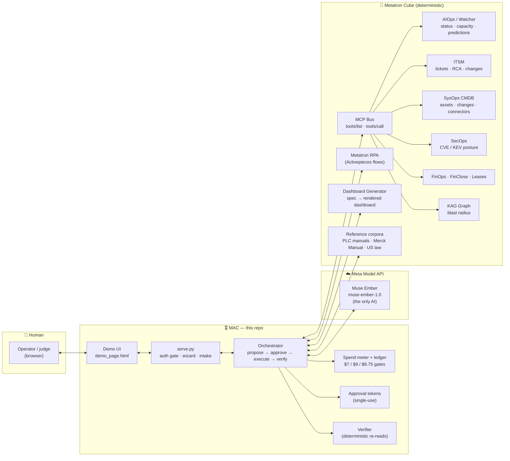
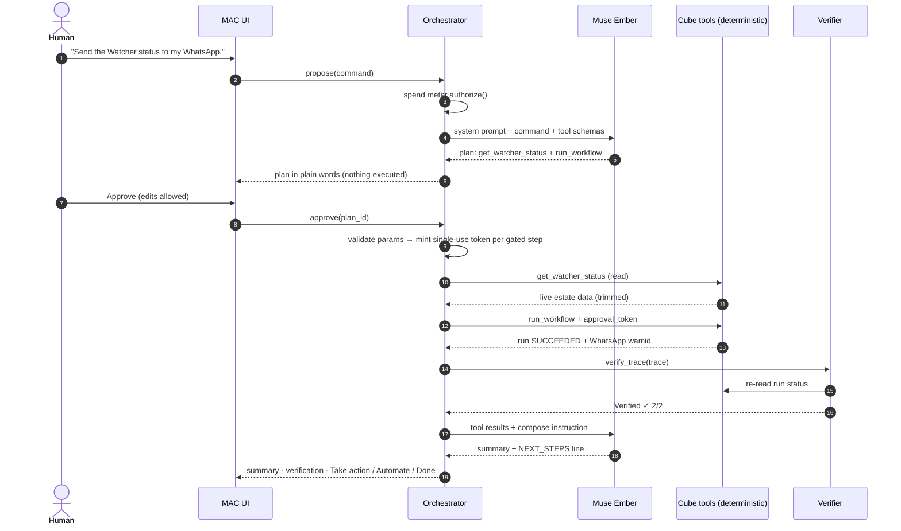

# MAC — Metatron Agentic Commander

**Powered by: Meta's Muse Ember**

> **You prompt. MAC checks. You approve. Metatron Cube executes.**


**MAC** puts **Muse Ember** — Meta's smallest, fastest model — in command of the **Metatron Cube**, a private AI + RPA appliance by [Metagen Group](https://metagengroup.com). You describe what you need in plain words. Ember plans the work over a catalog of **deterministic** Cube tools (workflows and data services that always do exactly what they say). A human reviews and approves the plan. Only then does the Cube execute — with no AI anywhere in the execution path. Afterwards, Ember verifies the result and suggests what to do next.

**▶ Live demo: [ember.metatroncube.online](https://ember.metatroncube.online)** — recorded demo replays are open to everyone (no login, $0); live runs need a Cube login (Operator+).

Built for the **Muse Ember Hackathon** (Cerebral Valley, Nov–Dec 2026). Application **accepted** Nov 25, 2026. Everything in this repo runs on Muse Ember as the **only** AI — see [Hackathon compliance](#hackathon-compliance).


*The MAC front page: hero, the six-stage orchestration rail (Human → Ember orchestrates → Approve → Metatron executes → Ember summarizes → Next), the composer, and the live spend meter in the MODEL strip. Screenshot captured Nov 27, 2026 from a locally served copy of the production page (recorded-only mode); the live deployment's meter reads ≈ $0.50 of $10.*

---

## Table of contents

- 🧭 [What is MAC?](#what-is-mac)
- ⚡ [How it works in 30 seconds](#how-it-works-in-30-seconds)
- 🏗️ [Architecture](#architecture)
- 🤝 [How Ember interfaces with the deterministic tools](#how-ember-interfaces-with-the-deterministic-tools)
  - [The tool catalog](#the-tool-catalog)
  - [Tool discovery over the MCP Bus](#tool-discovery-over-the-mcp-bus)
  - [Ember-local gated tools](#ember-local-gated-tools)
  - [The approval gate](#the-approval-gate)
  - [Deterministic execution](#deterministic-execution)
  - [The verification loop](#the-verification-loop)
  - [Spend meter and audit ledger](#spend-meter-and-audit-ledger)
  - [When no tool fits — the honest no](#when-no-tool-fits--the-honest-no)
  - [Deriving parameters from context](#deriving-parameters-from-context)
- 🧰 [Feature catalog](#feature-catalog)
  - [All 33 tools](#all-33-tools)
  - [The 19 demos in 4 groups](#the-19-demos-in-4-groups)
  - [Agent Builder Wizard](#agent-builder-wizard)
  - [Dashboard Builder](#dashboard-builder)
  - [Multimodal intake](#multimodal-intake)
  - [NEXT STEPS](#next-steps)
  - [Goals, suggestions, autonomy, undo](#goals-suggestions-autonomy-undo)
  - [Capabilities table ($0)](#capabilities-table-0)
  - [Medical and legal reference](#medical-and-legal-reference)
  - [PLC Code Converter](#plc-code-converter)
  - [File export](#file-export)
- 🛡️ [Safety and governance](#safety-and-governance)
- 🚀 [Quickstart](#quickstart)
- 🗂️ [Repo layout](#repo-layout)
- 🏆 [Hackathon compliance](#hackathon-compliance)
- 📚 [More documentation](#more-documentation)
- 📄 [License](#license)

---

## What is MAC?

MAC is an **agentic commander**: a natural-language front door to a private automation appliance.

The problem it solves: industrial and enterprise sites run powerful tools — monitoring, RPA (robotic process automation), ticketing, dashboards, security scanners — but those tools are locked behind expert interfaces, and the data often cannot leave the building. A shift supervisor should be able to say *"Send the Watcher status to my WhatsApp"* or *"Build a dashboard showing capacity and FinOps costs"* and get it done — without the AI ever touching production unsupervised.

MAC's answer is a strict division of labor:

| Role | Who | What they do |
|---|---|---|
| **Commander** | Muse Ember (Meta Model API) | Understands the request, plans over a fixed catalog of tools, writes the summary |
| **Approver** | A human | Reviews the exact plan (and can edit it) before anything runs |
| **Executor** | Metatron Cube (deterministic services + RPA) | Runs the approved steps exactly as specified — no model, no improvisation |
| **Verifier** | Deterministic code | Re-reads the resulting state and reports ✓/✗ per step |

**Why Ember?** Muse Ember is Meta's execution-tier model: fast, cheap ($0.10 per million input tokens, $0.50 per million output at ≤200K context), multimodal (text, image, audio, video, PDF in), with a 1M-token context window and native tool calling. MAC leans on exactly those strengths: tool-call planning, multimodal reading, and long-context reference (vendor manuals, a 4,114-page medical manual, ~187M tokens of US law) — all inside a hard **$10** hackathon budget. The entire build so far — every experiment, test, and live run — has cost about **$0.50** (see [Spend meter and audit ledger](#spend-meter-and-audit-ledger)).

**Why deterministic execution?** Because an LLM should never be the thing that sends the WhatsApp, files the ticket, or converts the PLC program unsupervised. Ember *proposes*; deterministic Cube workflows *execute*; a human *decides*. That pattern is what makes MAC safe to point at real operations.

---

## How it works in 30 seconds

Every interaction follows the six-stage rail at the top of the page:

1. **HUMAN** — you type (or tap a suggestion chip, or attach a file). Nothing has run yet.
2. **EMBER orchestrates** — Ember reads your request and proposes a plan: a list of tool calls with arguments. The plan is shown to you in plain words. Still nothing has run.
3. **APPROVE** — you review, edit if needed, and approve (or reject). Approval mints a **single-use token** for each step that changes something.
4. **METATRON executes** — the Cube runs the approved steps deterministically: RPA flows, data reads, file generation. No AI in this path.
5. **EMBER summarizes** — Ember writes the answer from the actual tool results, and deterministic code **verifies** each step against reality (✓/✗ with a fix if something's off).
6. **NEXT** — three buttons: **Take action** (a follow-up you can edit first), **Automate** (turn this into a recurring automation via the [Agent Builder Wizard](#agent-builder-wizard)), or **Done**.


*The USE CASES section: 19 prompt chips in 4 groups — AIOps, Process Automation, Business Use Cases, Grounding. Tapping a chip loads it into the composer (editable); it never auto-runs. Attach / Analyze / Paste Anything sit directly under the chat box.*

---

## Architecture

MAC is a thin, stdlib-only Python service (`serve.py`, port 8023 on the Cube) wrapping an orchestrator core (`orchestrator/`). Ember is reached over the Meta Model API. Everything Ember can touch is enumerated in `tools/catalog.json` and discovered live from the Cube's MCP Bus.



And one full run, step by step:



Deeper internals — token lifecycle, validation layers, merge rules, ledger schema, failure modes — are in [docs/ARCHITECTURE.md](docs/ARCHITECTURE.md).

---

## How Ember interfaces with the deterministic tools

This is the heart of MAC: Ember never touches the Cube directly. It speaks in **tool calls** — structured requests like `capacity_report()` or `run_workflow(workflow_id="watcher-status-whatsapp")` — and MAC's orchestrator decides what may run, when, and with whose permission. Five mechanisms make that safe and explainable.

### The tool catalog

Everything Ember may do is enumerated in [`tools/catalog.json`](tools/catalog.json) (version `1.2.0-paralegal`, **33 tools**). Each entry has a name, a one-line description, and a JSON Schema for its parameters — the same function-calling format the Meta Model API accepts. The catalog is the contract: if a capability is not in it, Ember cannot propose it, and the system prompt tells Ember to say so plainly (see [When no tool fits](#when-no-tool-fits--the-honest-no)).

The 33 tools split into two kinds:

- **24 read-only tools** — pure data fetches (status, capacity, costs, CVEs, CMDB assets, blast radius…). They change nothing, so they need no token — but they still only execute inside an approved plan.
- **9 gated tools** — anything with a side effect: `run_workflow`, `file_tickets`, `create_agent_flow`, `enable_agent_flow`, `file_intake`, `file_document_report`, `export_file`, `create_dashboard`, `convert_plc_code`. Each gated step requires a [single-use approval token](#the-approval-gate) that only the human approval step can mint. Ember never sees the token.

See [All 33 tools](#all-33-tools) for the full table.

### Tool discovery over the MCP Bus

The Cube exposes its services through a **Metatron MCP Bus** (Model Context Protocol — a standard JSON-RPC interface where tools describe themselves). At startup, MAC asks the bus for `tools/list`, generates Ember's function-calling schemas from the returned JSON Schemas, and routes executions through `tools/call` (`orchestrator/mcp_discovery.py`). New Cube capabilities become available to Ember automatically — no code change in MAC.

Discovery is **eligibility-filtered**, because the hackathon rule is *Ember is the only AI in the path*:

| Bus tool | Why it's filtered out |
|---|---|
| `create_ticket` | Triggers the Cube's local-model auto-triage — a non-Ember AI |
| `knowledge_search` | Runs an embedding model — a non-Ember AI |
| `ask_cube` | Calls the Cube's local LLM directly |
| `ember_*` | MAC's own tools on the bus — Ember never calls itself |

If discovery fails (bus down, bad payload), MAC falls back to the static catalog and the demo runs exactly as before. Discovery refreshes on a 300-second TTL. The merge rule: for a tool present in both, the discovered schema wins, except `required` fields are unioned with the catalog's hand-tuned ones.

MAC also runs the other direction: it **publishes** three tools on the bus (`ember_status`, `ember_propose`, `ember_list_automations`) so other Cube agents can ask Ember for a plan — but deliberately **no approve/execute tool**. Approval stays in the MAC UI where the token is minted. See [docs/ARCHITECTURE.md](docs/ARCHITECTURE.md#mcp-discovery-merge-rules).

### Ember-local gated tools

Some tools live inside MAC itself rather than on the bus — the nine gated writes plus the reference tools (`ask_medical_manual`, `ask_paralegal`) and a few local reads. These are never replaced by discovery. Two design choices matter:

- **Ember proposes parameters, never raw artifacts.** For `create_agent_flow`, Ember supplies high-level params (name, trigger, source, actions, optional condition) — it never emits RPA flow JSON. A deterministic validator (`orchestrator/agent_builder.py`) checks them against a strict allowlist and assembles the flow from proven step shapes. The result is always a **DISABLED draft**.
- **Ember authors content where judgment is needed, code validates where certainty is needed.** For `convert_plc_code`, Ember writes the converted program *and* a per-instruction coverage report at propose time (so the human approves the actual code); a deterministic validator then proves every source instruction is accounted for before approval is even offered.

### The approval gate

Approval is the only path from a proposal to an execution:

1. Ember's plan is stored as `proposed`. Nothing has run.
2. The human reviews it in the UI — in plain words ("Every weekday at 6:00 AM, Metatron will fetch the Capacity report and send it to your WhatsApp — only if Disk % > 80. Nothing runs until you enable it."). Parameters are editable; edits are **re-validated against the allowlist before any token is minted** (a failed validation runs nothing and leaves the plan untouched).
3. On approve, the orchestrator mints a **fresh single-use token** (`secrets.token_hex`) for each gated step and injects it into that step's arguments. The token is never shown to Ember and is stripped from the audit trace.
4. Each gated tool **consumes** its token on first use. A replayed, forged, or missing token is refused — `run_workflow` cryptographically cannot fire without one.
5. The trace records both Ember's proposed arguments and the final (possibly human-edited) arguments, so *what was approved* is auditable.

Plans are capped at **8 steps** (`STEP_CAP`). Rejection is always available and runs nothing.

### Deterministic execution

Once approved, steps execute in order through `orchestrator/cube_tools.py` — plain HTTP calls to Cube services and RPA webhooks. No model runs in this path, so execution costs **$0** and is reproducible. Read payloads are **trimmed deterministically** before Ember sees them (lists capped, strings truncated, depth limited), which keeps Ember's context — and the bill — small. Tool errors are fed back into the trace as data, not crashes: Ember reports them honestly in the summary.

### The verification loop

After execution, `orchestrator/verifier.py` re-reads reality with deterministic checks ($0, no model):

- created flow → is it in the registry? enabled flow → is it actually ENABLED?
- workflow run → status SUCCEEDED? (with the WhatsApp message id when the flow returns one)
- filed tickets → on the board? filed intake → in the store? export → file exists, size > 0?
- dashboard → registered *and* its page serves? PLC conversion → stored with a complete coverage report?
- medical/legal answers → passages present iff `covered` is true (no invented passages)?

The UI shows **"EMBER · VERIFIED ✓"** or **"COULD NOT VERIFY ✗"** with the fix named. A failed check is never silently retried — gated actions need a fresh human approval.

### Spend meter and audit ledger

Every Ember call passes through `orchestrator/spend.py` **before** it is made and is recorded after it returns — purpose tag, tokens in/out, cost, running total. Hard gates protect the $10 hackathon budget:

| Gate | Effect |
|---|---|
| **$7.00** | Warning state (meter turns amber in the UI) |
| **$9.00** | Non-essential purposes (experiment/test/rehearsal) halt |
| **$9.75** | Absolute stop — no further Ember calls, any purpose |

The ledger exports JSON + CSV — which doubles as the submission's required prompt/token trace. Stub-first development (a deterministic stub Ember client + fixture tools) meant all building and debugging cost $0; the live meter reads ≈ **$0.50 of $10** after the full build (Nov 27, 2026; final figure lands at the Dec 1 freeze). A typical full demo run costs a fraction of a cent — the medical replay above: 25,853 tokens in, 984 out, **$0.003077**.

### When no tool fits — the honest no

If a request matches no tool, Ember says so plainly, names what it *can* do, and executes nothing. The [Grounding demo group](#the-19-demos-in-4-groups) proves it: *"Order a pizza for the office and book a flight to Denver"* → a clean refusal. The same honesty applies inside tools: the medical and legal reference tools return `covered=false` with **no passages** when the corpus doesn't cover a question, and Ember must say so rather than answer from general knowledge.

### Deriving parameters from context

One subtle rule, learned from a real failure (Nov 26): when a user says *"Build a new automated agentic workflow"* after a capacity check, Ember **derives** the missing parameters from the run context (source from the tools just used, trigger defaulting to daily 06:00 America/Chicago, name and actions from context) instead of refusing for missing fields. Proposing derived defaults is safe because a human reviews and edits every parameter before approval, and the result is only a DISABLED draft. Refusal happens only when there is genuinely no context — in which case MAC asks **one** clarifying question with tappable answers, chosen by a deterministic confidence guard (`assess_confidence` in `orchestrator/orchestrator.py`). Every plan also carries a confidence chip (high/medium/low).

---

## Feature catalog

### All 33 tools

Grouped by capability area (the same grouping the page's [capabilities table](#capabilities-table-0) shows). 🔒 = gated (needs human approval + single-use token); all others are read-only.

#### IT Operations (14)

| Tool | What it does | Try saying |
|---|---|---|
| `cube_status` | Live estate status — components up/down, host vitals, open incidents | "Give me the overall Cube status." |
| `get_watcher_status` | Watcher status from AIOps — components, incidents, host | "Give me the shift handover brief." |
| 🔒 `run_workflow` | Fire a deterministic workflow (e.g. Watcher status → WhatsApp) | "Send the Watcher status to my WhatsApp." |
| `get_run_status` | Check the result of a workflow run | "Check the status of that workflow run." |
| `list_workflows` | List the deterministic workflows Ember can call | "List the workflows you can run." |
| `brain_status` | Which local brain is live — Axion or Qwen | "Which brain is live right now?" |
| `list_assets` | List CMDB assets from SysOps | "List the CMDB assets." |
| `get_asset` | Show one CMDB asset with its relationships | "Show me asset CI-0001." |
| `list_changes` | Recent change-register entries | "Show recent changes." |
| `list_connectors` | CMDB connectors configured in SysOps and their status | "Which CMDB connectors are configured?" |
| `list_dashboards` | List dashboards from the Dashboard Generator | "List the dashboards." |
| `list_flows` | List Metatron RPA flows with status | "List the Metatron RPA flows." |
| `graph_search` | Search the knowledge graph by label | "Search the knowledge graph for the brain." |
| `list_rca` | Root-cause and auto-heal records from ITSM | "List the RCA records." |

#### Help Desk (3)

| Tool | What it does | Try saying |
|---|---|---|
| `list_tickets` | List ITSM tickets (never creates) | "List the current ITSM tickets." |
| 🔒 `file_tickets` | File triaged tickets with draft replies to the board — nothing is sent | "Triage these help-desk tickets…" |
| `sentiment_summary` | Ticket sentiment — frustrated users and escalation risk | "How frustrated are our users?" |

#### Finance (3)

| Tool | What it does | Try saying |
|---|---|---|
| `finops_summary` | Cube run costs — today, month-to-date, projected, budget % | "What is the Cube costing us this month?" |
| `finclose_summary` | FinClose demo month-end KPIs — revenue, margins, EBITDA (simulated) | "Show the month-end close KPIs." |
| `list_leases` | Lease & Acquisition summary — pipeline and expiring leases | "Show the lease and acquisition summary." |

#### Security (1) · Risk & Impact (2) · Capacity Planning (1)

| Tool | What it does | Try saying |
|---|---|---|
| `secops_status` | CVE posture — critical/high counts, KEV exposure, top priorities (never investigates) | "Any critical CVEs we should worry about?" |
| `graph_dependents` | Blast radius — what depends on a component | "What breaks if the brain goes down?" |
| `predictions` | Failure predictions — per-component risk scores and reasons | "What are the current failure predictions?" |
| `capacity_report` | Capacity and headroom — host saturation and disk forecast | "How is our capacity looking?" |

#### Build & Automate (4)

| Tool | What it does | Try saying |
|---|---|---|
| 🔒 `create_agent_flow` | Build a deterministic RPA workflow from plain words — created DISABLED | "Build a new automated agentic workflow." |
| 🔒 `create_dashboard` | Build a live dashboard — Ember designs, Metatron renders | "Build a dashboard showing capacity and FinOps costs." |
| 🔒 `convert_plc_code` | Convert PLC code Allen-Bradley ⇄ Siemens using vendor manuals — DRAFT, nothing deploys | "Convert the sample Allen-Bradley conveyor program to Siemens SCL." |
| 🔒 `enable_agent_flow` | Publish + enable a DISABLED agent draft from the registry | "Enable the automation flow I just built." |

#### Medical Reference (1) · Legal Reference (1)

| Tool | What it does | Try saying |
|---|---|---|
| `ask_medical_manual` | Ask The Merck Manual (19th Ed.) — cited passages; says so when not covered. Not medical advice | "What does the manual say about the symptoms of acute viral hepatitis?" |
| `ask_paralegal` | Ask over the U.S. Code, Federal Rules, Constitution, CFR — per-section citations. Not legal advice | "What does the law say about federal-question jurisdiction?" |

#### Document Intake (3)

| Tool | What it does | Try saying |
|---|---|---|
| 🔒 `file_intake` | File fields Ember extracted from an attached photo, PDF, audio or video | "Attach an invoice photo — Ember reads it and files the extracted fields." |
| 🔒 `file_document_report` | File a document-analysis report with line-referenced findings | "Paste a log file — Ember finds the anomalies and files a report." |
| 🔒 `export_file` | Export filed data as CSV, Excel, Word, TXT, or JSON — deterministic, $0 | "Save that transcript as a Word file." |

### The 19 demos in 4 groups

The page's DEMO panel holds 19 recorded replays of real runs (free, no login) — each also runnable live with a Cube login. Groups tell one story: **operate → automate → business value → trust**.

**1 · AIOps** — *Ember reads live estate data and acts, with your approval.*

| Demo | What it proves |
|---|---|
| Watcher Status → WhatsApp | Live telemetry read + a real RPA send to a phone, gated by approval |
| Shift Handover Brief | A written brief composed only from returned facts |
| Full Picture Brief | Five chained read tools consolidated into one brief |
| Help-desk Triage Desk | Classify + draft replies for 5 tickets; file only after approval |
| FinOps Summary | Cost question answered from the Cube's own FinOps service |
| CVE Exposure Check | CISO question from live threat data (read-only) |
| Blast Radius | Knowledge-graph walk: everything that depends on the brain |
| Capacity Outlook | Forecasts + failure-prediction watch list |

**2 · Process Automation** — *Ember designs it, you approve it, Metatron RPA runs it.*

| Demo | What it proves |
|---|---|
| Agent Builder | Plain words → validated RPA process → DISABLED draft |
| Dashboard Builder | Plain words → Ember-authored spec → deterministically rendered live dashboard |

**3 · Business Use Cases** — *Ember works from long-context reference: manuals, code, law.*

| Demo | What it proves |
|---|---|
| PLC Code Converter | ~180K tokens of vendor manuals as context; per-instruction coverage report; DRAFT + change approval |
| Multimodal Intake | Ember reads an invoice photo directly (no OCR engine); deterministic totals check |
| PDF Intake | PDF read end-to-end (text + page images), fields filed after approval |
| Audio Intake | Voice note transcribed by Ember itself; action items filed |
| Video Intake | MP4 watched + listened to; on-screen text and summary filed |
| Document Intelligence | Long log parsed; findings report with line references |
| Medical Manual Q&A | Per-chapter cited summaries from the Merck Manual; honest "not covered" |
| Paralegal Assistant | Per-source cited summaries from US public-domain law |

**4 · Grounding** — *Ember refuses what it can't do, and says why.*

| Demo | What it proves |
|---|---|
| The Honest "No" | Out-of-catalog request refused plainly; nothing executed |

Recordings live in `demos/recorded.json` (recorded Nov 27, 2026, model `muse-ember-1.0`); each card shows the run's real cost and token counts. How the demos map to the judging criteria is in [docs/DEMO-GUIDE.md](docs/DEMO-GUIDE.md).

### Agent Builder Wizard

The wizard turns a one-off run into a recurring automation — entirely inside the MAC page, with every approval in-screen. Four steps: **1 · What → 2 · Describe → 3 · Review & customize → 4 · Approve & create**.


*After any run, NEXT STEPS offers Take action / Automate / Done. Automate opens the wizard at "What do you need?" — pick a template, answer questions from scratch, or describe it and let Ember design.*

Three ways in:

- **7 pre-built templates** (deterministic, $0 — no Ember call): Morning Watcher Status → WhatsApp · Capacity Disk Alert → WhatsApp (only if disk > 80%) · Daily Capacity Report → board · FinOps Weekly Summary → board · Failure Predictions Digest → board · SecOps CVE Posture → board · DOT Bid Digest → board.
- **Start from scratch — 5 guided questions**: What do you want to keep an eye on? · How often should it run? · What should happen with the report? · Only when…? · Anything else Ember should know? A live "Metatron tools Ember will use" panel updates per answer (with live current values, e.g. *"only when disk is over 80% · now 69.9"*), and answers assemble deterministically into the Review step. An optional **"Ask Ember to refine"** makes one Ember design call.
- **Describe it yourself** — "Ask Ember to design it" sends your words plus run context to Ember, which must return exactly one `create_agent_flow` step (else HTTP 422).

The **process model** every automation follows: *Trigger (schedule cron or webhook) → Fetch one of 6 allowlisted Cube sources → optional condition gate (numeric threshold) → one or both actions (WhatsApp and/or board filing) → return*. Multi-step chains up to 4 steps are supported. Review shows a live plain-words summary and a numbered process list; every edit re-validates deterministically ($0). **Approve & create** produces a **DISABLED** RPA draft. Then:

- **Test** — a deterministic dry-run: computes the next fire time, fetches live source data, evaluates the condition, composes the exact message — and **captures it without sending**. Works on DISABLED and ENABLED flows.
- **Enable** — a second, separate approval (`enable_agent_flow`, registry-scoped) publishes the draft. Nothing runs until a human enables it.
- **Edit flow ↗** — deep-links into the RPA console for manual tweaks (editing is not an approval).

### Dashboard Builder

*"Ember designs the dashboard, I approve, Metatron renders it."* Ember authors a dashboard **spec** — title, 1–3 allowlisted Cube data sources (watcher-overview, capacity, predictions, finops, leases, sentiment, finclose, dotkrc-status, agents-status), KPI cards, charts, optional table and thresholds — against the **live data profile** injected into its context (real field names with sample values). A deterministic validator mirrors the Dashboard Generator's rules (caps: 8 KPIs, 4 charts, 8 thresholds); an invalid spec gets one repair retry with the validator's teaching error, then a clean refusal — it never reaches approval broken. On approval, the generator renders it deterministically; Ember specs carry `insight: false, chat: false`, so **no Cube-side model runs** at create, refresh, or render. Optional scheduled refresh creates a DISABLED RPA flow. Ember-built dashboards show "← Return to Ember" and can be undone (deleted) from the stage. Live example: [dashboards.metatroncube.online](https://dashboards.metatroncube.online).

### Multimodal intake

One attach control — **Attach anything / Analyze / Paste Anything** (file picker, clipboard paste, drag-and-drop, all the same path) — feeds Ember's multimodal input directly. **No OCR, speech-to-text, or embedding model runs in this path; Ember reads, listens, and watches itself.**

| Kind | Formats | Cap | Ember extracts |
|---|---|---|---|
| Image | PNG / JPEG / WebP / GIF (HEIC normalized in-browser) | 5 MB | Invoice fields: vendor, number, date, PO, line items, subtotal, total |
| PDF | PDF | 10 MB | Same field extraction from text + page images |
| Audio | MP3 / WAV | 10 MB | Exact transcript + structured items heard (work orders, tasks, dates) |
| Video | MP4 | 20 MB | On-screen text, summary, speech transcript |
| Text | .txt / .log / .md / .json | 200K chars | Document analysis → findings report with line references |

Honest limits: **MP4 video only; MP3/WAV audio only** — m4a/mov/webm are rejected with a clear error (no transcoding built). Filing always needs approval. Invoice totals are verified by **deterministic code** (`orchestrator/intake_totals.py`), never by the model's own arithmetic: it checks items-vs-subtotal, subtotal+tax−discount+shipping-vs-total, and balance arithmetic — and treats the classic "model copied the total into amount_paid" pattern as unreliable extraction rather than flagging a correct invoice. Ember reports the verifier's verdict exactly.

### NEXT STEPS

Every run ends with three buttons: **Take action** (Ember's specific follow-up suggestions, or a deterministic default derived from the trace — opens an *inline editable prompt* so you can change the words before sending), **Automate** (opens the [Agent Builder Wizard](#agent-builder-wizard) with run context), and **Done** ("Glad to be of service." — zero API calls). Suggestions come from a `NEXT_STEPS:` line Ember appends to its summary (parsed and stripped by code — one call does both jobs), validated for shape, and still go through the normal propose→approve path, so a bad suggestion can do no harm.

### Goals, suggestions, autonomy, undo

- **Goals** — state an outcome ("disk stays under 80%"); MAC tracks one metric per goal and reports progress after every run.
- **Suggested for you** — deterministic rules over live data propose automations ("Disk is at 69.9% — want a daily alert at 80%?"); tapping one opens the wizard pre-filled. $0.
- **Autonomy levels** — per automation: `propose-only` (default), `auto-report`, `auto-silent`. The RPA flow is unchanged; the level governs reporting, and the UI says so honestly rather than faking it.
- **Undo** — one-tap reversal for created flows (disable+delete), enablements (disable), board tickets, dashboards, and exports. WhatsApp honestly shows "can't be unsent."
- **Learns from edits** — wizard edits are remembered (preferred schedules/actions/sources) and offered back next time, with a reset control.

### Capabilities table ($0)

Ask *"What can you do?"* and MAC answers with a grouped table of all 33 tools — built from the catalog by deterministic code, **before** any Ember call, consuming no budget and no daily-cap slot. The match is whole-command only, so "What can you do about capacity?" still goes to Ember as a real question.

### Medical and legal reference

Two read-only tools demonstrate **long-context reference with deterministic retrieval** — the "RAG without the embeddings" pattern: keyword BM25 (a classic text-ranking algorithm) over chunked corpora, in-process, no vector database, no Cube-side model. Ember answers **only** from returned passages, paraphrased, with a citation per claim; a disclaimer is appended by deterministic code on every answer, never left to the model.


*A recorded Medical Manual Q&A run: one summary block per relevant chapter (Chapter 149. Viruses, Chapter 128. Transplantation…), a cross-chapter synthesis, per-claim citations, the deterministic disclaimer, and the run's real cost — $0.003077.*

| | Medical Manual Q&A | Paralegal Assistant |
|---|---|---|
| Corpus | *The Merck Manual of Diagnosis & Therapy*, 19th Ed. — 4,114 pages, 17,651 chunks (~2.88M tokens) | US public-domain law — U.S. Code (88,234 sections), Federal Rules (Civil/Criminal/Appellate/Bankruptcy/Evidence), U.S. Constitution, CFR (324,148 sections) — 413,116 chunks (~187M tokens) |
| Retrieval | BM25 with title/section boosts, neighbour expansion, ~160K-char (~40K-token) reference budget per answer | SQLite FTS5 BM25, same budget; passages grouped by source/title |
| Answer shape | One block per relevant chapter (≤5) + synthesis | One block per relevant source/title (≤5) + synthesis |
| Citations | `(Chapter 28. Hepatitis — Diagnosis, pp. 324-325)` | `(28 U.S.C. § 1331)`, `(Fed. R. Civ. P. 26(b)(1))`, `(29 C.F.R. § 1910.95)` |
| Not covered | `covered=false` → "the manual does not cover that" | `covered=false` → "these sources do not cover that" |
| Guardrail | ⚕️ "Demo — information from The Merck Manual… Not medical advice" | ⚖️ "Demo — legal information… Not legal advice" |

Honest gaps: the Appellate Rules use the official Dec 1, 2024 edition (the Dec 2025 PDF's font encoding extracts as glyph codes); CFR Title 35 has no 2025 bulk zip; the corpora live on the Cube only (copyrighted/oversized — never committed to this repo).

### PLC Code Converter

The centerpiece long-context + coding demo: convert industrial PLC programs between **Allen-Bradley** (Studio 5000 / Logix) and **Siemens** (S7-1200/1500 SCL), both directions.

- **Manuals as long context**: 5 vendor documents (Rockwell 1756-RM003 General Instructions, 911 pp; Rockwell Structured Text; Siemens S7-1200 System Manual, 1,028 pp; Siemens Styleguide + Programming Guideline — 2,053 pages, ~769K tokens total) are injected by deterministic file reads at conversion time (~720K chars ≈ **180K tokens** per conversion). Ember is API-only — there is no fine-tuning; the manuals are *reference*, and Ember's 1M-token window is what makes this work.
- **Coverage validator**: every source instruction must appear in the coverage report as *mapped* (with its target equivalent) or *flagged unsupported* (with a redesign note) — unsupported instructions are **never silently replaced**, source-only mnemonics must not survive into the output, and named target instructions must actually be used. Proven runs: AB→Siemens 6 mapped / 2 flagged (RES, MSG); Siemens→AB 3 mapped / 1 flagged (WRREC).
- **Governance**: output is **DRAFT**, labelled demo, for **qualified-engineer review** — never auto-deployed, never claimed safety-certified. On approval, a Metatron RPA flow files an ITSM change record and pauses at an approval waitpoint for acceptance.

### File export

`export_file` turns filed data into a downloadable file — **CSV, XLSX (Excel), JSON, TXT, DOCX (Word)** — generated by deterministic code after approval ($0). Sources: the latest intake extraction (line items as proper columns), the triage board, the latest document report, the last run's results, the latest PLC conversion, medical answer, or legal answer. Downloads are Operator+-gated and listed in the Exports panel.

---

## Safety and governance

- **A human approves every action.** Reads execute only inside approved plans; side effects additionally require a single-use token minted at approval. There is no path from a prompt to an execution that skips the gate.
- **Nothing runs unsupervised.** Agent Builder output is always a DISABLED draft; enabling is a second, separate approval. Dashboard refresh flows are created DISABLED. Payment is never automated by design.
- **Ember is the only AI.** Three bus tools that would invoke other models (`create_ticket`, `knowledge_search`, `ask_cube`) are filtered out at discovery; Ember-built dashboards disable Cube-side insight/chat; built RPA flows contain zero LLM steps; retrieval is deterministic BM25/FTS5. The local Cube brains (Qwen/Axion) are shown greyed-out in the UI — "not used in this demo."
- **No approve/execute on the MCP Bus.** MAC publishes `ember_propose` for other agents, but approval stays in the UI. A bus caller can get a plan, never an execution.
- **Honest labelling.** Demo data is labelled demo (FinClose KPIs are simulated); PLC output is DRAFT for qualified-engineer review; medical/legal answers carry deterministic disclaimers and never give personalized advice; `covered=false` is said out loud.
- **Auditability.** Every Ember call is in the spend ledger; every plan's trace records proposed vs final arguments; every execution is verified by re-read. Live runs are Operator+-gated behind the Cube's own session auth, with a 1,000/day cap.
- **Undo where possible, honesty where not.** Flows, tickets, dashboards, and exports can be undone in one tap; a sent WhatsApp says "can't be unsent."

## Quickstart

No dependencies beyond the **Python 3.11+ standard library** (the Excel/Word exporters use `openpyxl`/`python-docx` if present — on the Cube they live in an app-local vendor dir; everything else is stdlib).

### Run it offline ($0, no API key)

```bash
git clone https://github.com/rsiquijor/ember-orchestrator.git
cd ember-orchestrator
python3 -m unittest discover -s tests      # 479 tests, stub client, $0
python3 run_demo.py                        # two scripted demos in the terminal
python3 serve.py                           # demo UI (recorded-only mode without a key)
```

Without `MODEL_API_KEY`, `serve.py` starts in **recorded-only mode**: the page, all 19 recorded replays, the capabilities table, and the wizard's deterministic paths work; live Ember calls are disabled with a clear message.

### Run it live (Meta Model API)

```bash
export MODEL_API_KEY=...                    # or META_MODEL_API_KEY
export EMBER_RATE_INPUT_PER_1K=0.0001       # $0.10 / 1M input tokens
export EMBER_RATE_OUTPUT_PER_1K=0.0005      # $0.50 / 1M output tokens
python3 serve.py                            # http://127.0.0.1:8023
```

| Env var | Default | Meaning |
|---|---|---|
| `MODEL_API_KEY` / `META_MODEL_API_KEY` | — | Meta Model API key (required for live mode) |
| `EMBER_MODEL_ID` | `muse-ember-1.0` | Model id |
| `EMBER_BASE_URL` | `https://api.meta.ai/v1` | API base URL |
| `EMBER_MAX_TOKENS` | `512` | Default propose budget (retries escalate to 4,096 on truncation) |
| `EMBER_REASONING_EFFORT` | `minimal` | Reasoning effort ("none" is rejected by the API) |
| `EMBER_RATE_INPUT_PER_1K` / `EMBER_RATE_OUTPUT_PER_1K` | — | Meter rates; live mode refuses to run unmetered |
| `EMBER_UI_PORT` | `8023` | Demo UI port |
| `EMBER_UI_DAILY_CAP` | `1000` | Live runs per day |
| `MCP_DISCOVERY_TTL_S` | `300` | Bus discovery cache TTL (0 = off) |

On the Cube, `run_live.sh` sources the key and bus credentials from the box's env files at runtime — the key is never in this repo.

## Repo layout

| Path | What |
|---|---|
| `serve.py` | The MAC service: demo UI host, auth gate, wizard/intake/goals/suggestions/undo endpoints, MCP service-key routes |
| `demo_page.html` | The single-page demo UI (stage rail, composer, USE CASES chips, DEMO panel, wizard) |
| `orchestrator/orchestrator.py` | Propose → approve → execute → verify loop, system prompt, NEXT STEPS, confidence guard |
| `orchestrator/ember_client.py` | Ember adapter: `MetaEmberClient` (live) + `StubEmberClient` (deterministic, $0) |
| `orchestrator/cube_tools.py` | Cube Tool API: fixture + HTTP backends, approval tokens, gated-tool enforcement |
| `orchestrator/mcp_discovery.py` | MCP Bus `tools/list` discovery, eligibility filtering, schema merge |
| `orchestrator/spend.py` | Spend meter, budget gates, trace ledger + JSON/CSV export |
| `orchestrator/verifier.py` | Deterministic post-execution verification |
| `orchestrator/agent_builder.py` | Agent param validation, templates, scratch Q&A, RPA flow assembly |
| `orchestrator/dashboard_builder.py` | Dashboard spec validation + deterministic creation |
| `orchestrator/plc_converter.py` | PLC conversion validation (coverage report, mnemonic checks) |
| `orchestrator/medical_manual.py` / `legal_reference.py` | Deterministic BM25 / FTS5 retrieval over the reference corpora |
| `orchestrator/intake_totals.py` | Deterministic invoice-totals verification |
| `orchestrator/exporter.py` | Deterministic CSV/XLSX/JSON/TXT/DOCX generation |
| `tools/catalog.json` | The 33-tool catalog (v1.2.0-paralegal) — the only things Ember may call |
| `demos/recorded.json` | The 19 recorded demo runs (real runs, replayed free) |
| `fixtures/` | Reproducible demo data (tickets, invoices, logs) |
| `tests/` | 479 unit/integration tests (stub-backed, $0) |
| `docs/` | [ARCHITECTURE.md](docs/ARCHITECTURE.md), [DEMO-GUIDE.md](docs/DEMO-GUIDE.md), spend-meter spec, screenshots |

## Hackathon compliance

- **Ember-only AI functionality.** The submitted project's AI runs exclusively on Muse Ember (`muse-ember-1.0`, Meta Model API). Cube-side models are excluded by construction: three bus tools filtered at discovery, no LLM steps in built flows, deterministic retrieval (BM25/FTS5) instead of embeddings, Ember-authored dashboards with Cube insight/chat disabled, Ember itself reading images/audio/video/PDFs (no OCR/STT engines in the path).
- **$10 budget discipline.** Stub-first development ($0), a spend meter authorizing every call before it is made, gates at $7/$9/$9.75, an 8-step plan cap, deterministic payload trimming, and binary-scrubbing so attachments are never re-sent (or re-paid for) on the compose turn. **Total spend ≈ $0.50 of $10** (live meter, Nov 27, 2026; final figure at the Dec 1 freeze).
- **Prompt/token trace.** The spend ledger exports JSON + CSV (`spend/trace.json`, `spend/trace.csv`) with per-call purpose, tokens, and cost. *Note: the copy in this repo is a Nov 26 snapshot; the submission trace is exported fresh from the live deployment after the final rehearsal.*
- **Submission.** Public repo + 3-minute demo video + trace via the Cerebral Valley portal. Feature freeze **Dec 1**; submit **Dec 2 by noon ET**. See [docs/DEMO-GUIDE.md](docs/DEMO-GUIDE.md#submission-checklist).

## More documentation

- 📐 [docs/ARCHITECTURE.md](docs/ARCHITECTURE.md) — orchestrator internals: token lifecycle, validation layers, MCP merge rules, retrieval design, ledger schema, failure modes and honest limits.
- 🎬 [docs/DEMO-GUIDE.md](docs/DEMO-GUIDE.md) — the 19 demos mapped to the judging criteria (Technicality / Creativity / Demo / Potential), the refreshed 3-minute video script, and the submission checklist.
- 💸 [docs/spend-meter.md](docs/spend-meter.md) — spend meter spec and budget buckets.
- 🧊 The platform underneath: [metatroncube.online](https://metatroncube.online) · [AIOps console](https://aiops.metatroncube.online) · [ITSM](https://itsm.metatroncube.online) · [Dashboards](https://dashboards.metatroncube.online) · [Metagen Group](https://metagengroup.com)

## License

MIT — see [LICENSE](LICENSE). Copyright © 2026 Metagen Group LLC.

*MAC — Metatron Agentic Commander. You prompt. MAC checks. You approve. Metatron Cube executes.*
